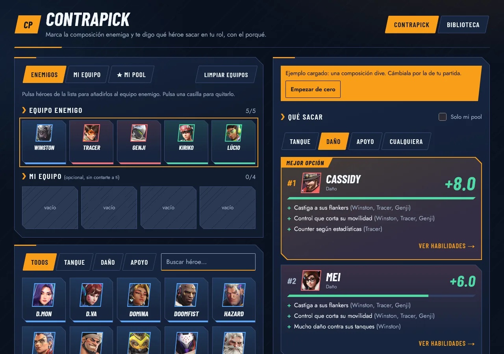
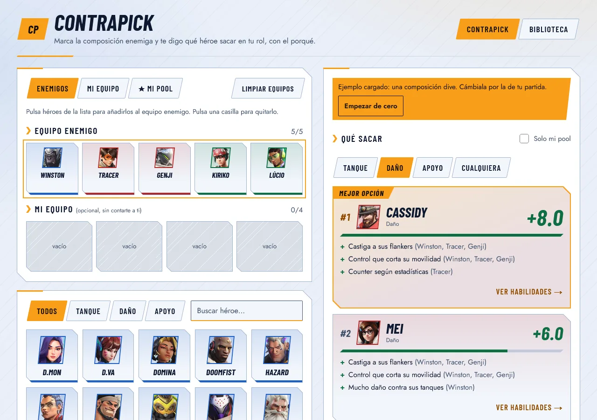
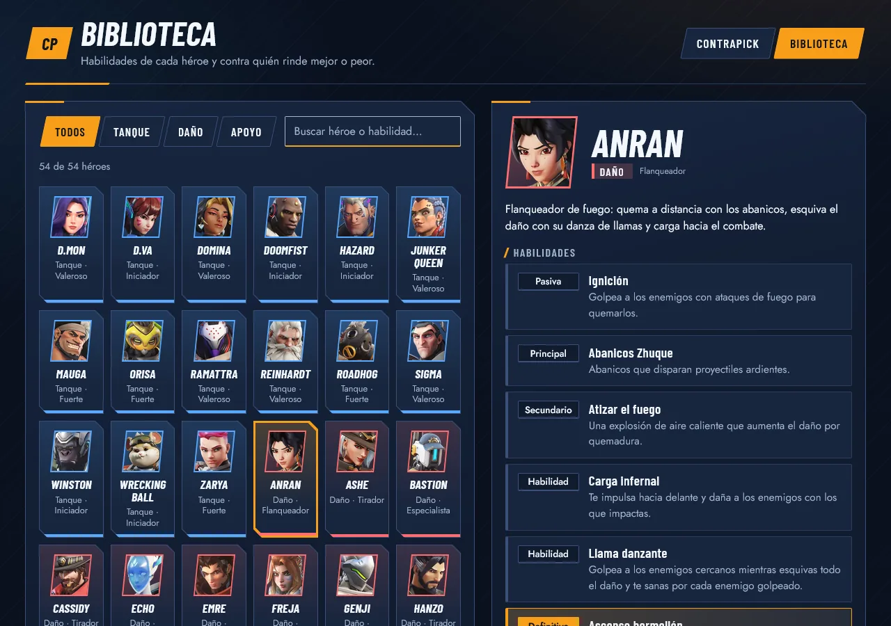
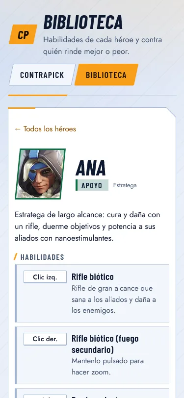

# Contrapick

Marca la composición enemiga de tu partida de Overwatch y Contrapick te dice qué héroe sacar en tu rol, con el porqué. Incluye una Biblioteca con las habilidades de los 54 héroes.

**Pruébalo online: https://shadowpj.github.io/ContraPick-OW/**



Proyecto de fans, sin relación con Blizzard Entertainment. Datos de la Temporada 5 (nov 2026).

## Qué hace

### Contrapick (`index.html`)

- **Marca enemigos y aliados.** Elige a quién añades con los botones *Enemigos*, *Mi equipo* o *Mi pool* y pulsa héroes de la lista. Pulsa una casilla ocupada para quitarlo. El equipo propio es opcional (hasta 4 aliados, sin contarte a ti).
- **Elige tu rol.** Tanque, Daño, Apoyo o Cualquiera.
- **Tu pool.** Marca los héroes que dominas con *★ Mi pool* y activa *Solo mi pool* para que las recomendaciones salgan solo de ahí.
- **Qué sacar.** Lista ordenada de héroes con una puntuación y el motivo de cada punto a favor o en contra (por ejemplo, "Castiga a sus flankers" o "Control que corta su movilidad").
- **Evita.** Los héroes de tu rol con peor puntuación contra esa composición.
- **Lectura del enemigo.** Las amenazas que plantea su composición y cómo responder en tu rol.
- **Enlace a la Biblioteca** desde cada recomendación ("Ver habilidades").
- Tu selección se guarda en el navegador (`localStorage`), sin cuentas ni servidor. Tema oscuro y claro, y diseño adaptado a móvil.

### Biblioteca (`biblioteca.html`)

- Los **54 héroes** con rol, subrol, pasiva, habilidades y definitiva, en español.
- **Buscador** por nombre de héroe o de habilidad, y filtro por rol.
- Para cada héroe, contra quién rinde mejor y contra quién peor (*fuerte contra* / *débil contra*).
- **Enlaces directos por héroe**: `biblioteca.html#anran`, `biblioteca.html#ana`, etc. (el identificador es el campo `id` de `heroes.json`).

## Capturas

| Contrapick, tema claro | Biblioteca, detalle de un héroe |
|---|---|
|  |  |

Vista móvil (375 px de ancho), Biblioteca en tema claro:



## Cómo funciona el motor

No hay servidor ni IA: es un cálculo de puntuación que corre en tu navegador sobre `heroes.json`.

1. **Reglas por etiquetas.** Cada héroe tiene `tags` (por ejemplo `hitscan`, `aereo`, `escudo`, `dive`, `antiheal`). Las `rules` del archivo dicen qué etiqueta funciona bien contra cuál, con un peso y un texto que explica el porqué (por ejemplo, `hitscan` contra `aereo`).
2. **Counters directos.** Cada héroe lista `beats` (contra quién es fuerte) y `losesTo` (quién lo counterea): son el top 5 de [counterwatch.gg](https://counterwatch.gg) (duelos y peleas de equipo, consultado el 22 nov 2026). El motor usa ambas listas en las dos direcciones.
3. **Sinergias y estilo.** Si marcas aliados, suman las sinergias de `synergies` (pares de héroes con una nota) y el encaje de estilo (`dive`, `brawl`, `poke`).

Todo está en [`heroes.json`](heroes.json) y se puede editar a mano. Las notas del archivo advierten de que no son estadísticas oficiales y de que cambian con cada parche, así que ajusta `beats`, `losesTo`, `tags` y `rules` a tu gusto.

## Uso local

El sitio es estático (HTML, CSS y JS sin dependencias ni paso de compilación), pero carga los datos con `fetch`, así que **no funciona abriendo el archivo con `file://`**. Sirve la carpeta con cualquier servidor estático, por ejemplo con Python:

```bash
git clone https://github.com/ShadowPJ/ContraPick-OW.git
cd ContraPick-OW
python -m http.server 8000
```

Abre después http://localhost:8000 (Contrapick) o http://localhost:8000/biblioteca.html (Biblioteca).

## Estructura del proyecto

```
.
├── index.html          Contrapick: selección de equipos, motor de recomendación y resultados
├── biblioteca.html     Biblioteca: búsqueda, filtro por rol y ficha de cada héroe
├── common.js           Helpers compartidos por las dos páginas (retratos, escape de texto, búsqueda)
├── styles.css          Estilos compartidos, temas claro y oscuro, @font-face
├── heroes.json         Roles, tags, counters (beats / losesTo), reglas y sinergias
├── abilities.json      Pasiva, habilidades y definitiva de cada héroe, con fuentes y marcas de verificación
├── img/                Retratos de los héroes (WebP 128 px) y manifest.json con su origen
├── fonts/              Fuentes autoalojadas (woff2) y sus licencias OFL
├── design-system/      Sistema de diseño generado para el rediseño visual
├── docs/screenshots/   Capturas usadas en este README
├── PROJECT_BRIEF_SDD.md  Brief del proyecto: problema, objetivos, alcance y criterios de aceptación
└── DECISION_LOG.md     Registro de decisiones del proyecto
```

## Datos y fuentes

- **Temporada 5 · nov 2026**, 54 héroes (15 tanques, 23 de daño, 16 de apoyo).
- **Habilidades** (`abilities.json`): nombres y descripciones tomados de las páginas oficiales de Blizzard en es-ES (`overwatch.blizzard.com/es-es/heroes/{héroe}/`), contrastados con las de en-US. Las fuentes completas están en el propio archivo.
- **Counters** (`heroes.json`): top 5 de counterwatch.gg, consultado el 22 nov 2026.

Limitaciones conocidas:

- **Mauga y Freja** están marcados como `verified: false`: sus datos no se pudieron confirmar contra la página oficial.
- **Teclas de 25 héroes** sin confirmar (`keysVerified: false`): las teclas son estimadas (valores por defecto de PC), así que la Biblioteca no las muestra para esos héroes y solo indica el tipo de habilidad (Principal, Secundario, Habilidad, Definitiva).
- Algunas habilidades llevan `tr: true`: no figuran en la página oficial y su texto es traducción propia o de una fuente no oficial.
- Los counters no son estadísticas oficiales y cambian con cada parche.

## Créditos y licencias

- **Tipografías:** [Barlow Condensed](https://github.com/jpt/barlow) y [Jost](https://github.com/indestructible-type/Jost), bajo la licencia SIL Open Font License 1.1. Los textos de licencia están en [`fonts/OFL-BarlowCondensed.txt`](fonts/OFL-BarlowCondensed.txt) y [`fonts/OFL-Jost.txt`](fonts/OFL-Jost.txt).
- **Retratos y nombres de héroes:** © Blizzard Entertainment. Overwatch y sus personajes son propiedad de Blizzard Entertainment, Inc.
- **Counters:** datos de [counterwatch.gg](https://counterwatch.gg).
- Este es un **proyecto de fans**: no está afiliado, patrocinado ni respaldado por Blizzard Entertainment.
- **Licencia del código:** pendiente de definir.
